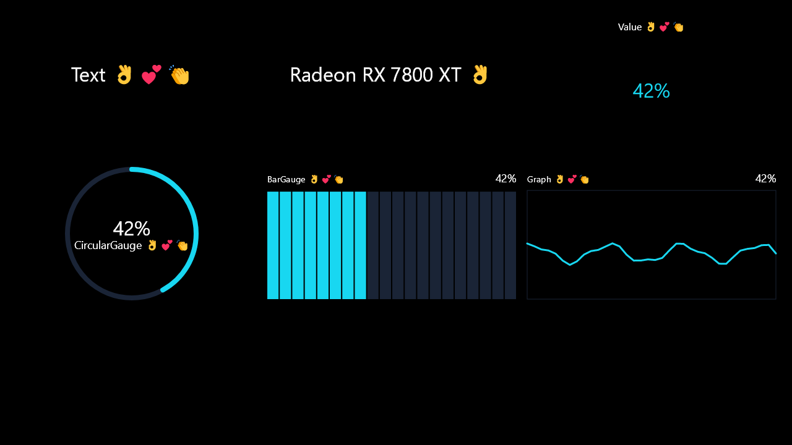

# Hardware names and colour emoji, alpha.13

[Windows workflow 38542263970](https://github.com/ManethonSega/PC-Info-Screen-Studio/actions/runs/38542263970) passed for branch source `28130cbd7c18aae1ee3485d41150771ff41df926`, with zero compiler warnings or errors. The complete WPF/controller suite, published executable and extracted portable ZIP checks passed.

## Checked behaviour

- Actual WPF Add → Hardware name in Info Screen and Hybrid.
- Detected model displayed in the property field; editing that field switches to custom text and subsequent detection does not overwrite it.
- Re-enabling automatic mode uses the latest detected name, while preserving the custom alternative.
- Cloning and Info Screen/Hybrid save/reopen preserve custom text and the selected mode; runtime detection remains excluded from saved files.
- RAM manufacturer/part-number formatting trims and deduplicates modules, excludes firmware placeholders and does not invent missing brands.
- Real Skia pixels are coloured for 👌💕👏, skin tones, 👩‍💻, ❤️, keycaps, watches and stars. The joined laptop sequence measures as a single shaped emoji.
- Mixed emoji render with a selected custom font in Text, Hardware name, Value, circular gauge, bar gauge and graph widgets.
- Photo captions retain coloured emoji with ordinary-text outlines.
- The real GPU search dropdown includes all eight numeric GPU sources plus the new GPU-name source.

## Visual review

The rendered bitmap and actual WPF widget-property capture below were reviewed. Emoji retain their yellow and pink palettes on the rendered canvas. The property text field uses native WPF and can show monochrome emoji; the renderer is shared with physical display output. Examples are illustrative, not a report of the runner's actual hardware.

## Limits

Windows firmware controls which RAM brands and model numbers are available. Multiple distinct drive/module names are combined; users can enter a shorter custom label. Hardware inventory is cached for the current app session and runs independently of low-level sensor permissions.

Available emoji depend on the installed Segoe UI Emoji version. This does not bundle Microsoft's font or guarantee support for newer Unicode sequences. Tests verify bitmap content and transport-independent rendering, not physical USB colour quality. The owner still needs to verify names on their own PC and appearance on the connected displays.
