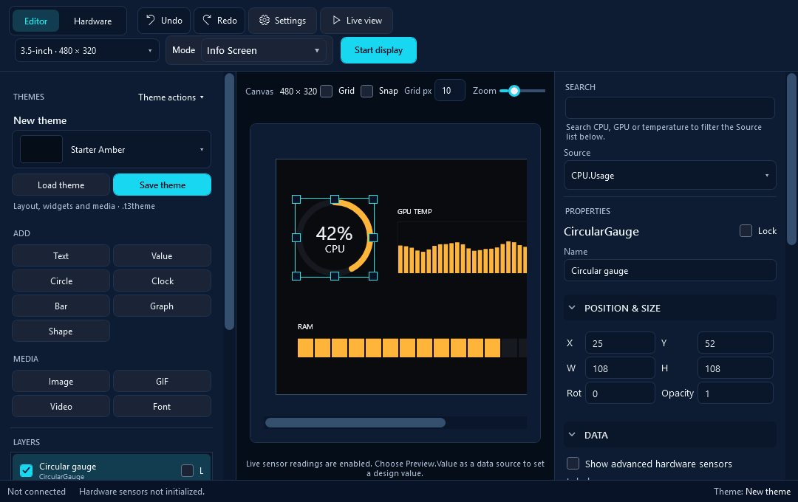

# Coordinated Studio UI, alpha.12

The supplied colour reference and MechKeyMesh's current `apps/desktop/frontend/dist/app.css` informed the shared palette and restrained component styling. The existing three-column editor, mode workspaces, navigation, commands, bindings, event handlers and named controls are retained.

Primary actions use Neon Aqua with Deep Navy labels. Secondary controls use Carbon Slate and derived navy surfaces. Mesh Cyan marks selections, Electric Blue marks keyboard focus, and Accent Orange marks numeric validation. Silver White and a lighter derived slate support readable text. Theme artwork colours are not changed.

## Verification

[Windows workflow 38524545708](https://github.com/ManethonSega/PC-Info-Screen-Studio/actions/runs/38524545708) passed for source `97c9d4c6fdc7bbaa2ce0ad3026ea3dc820aa2c29`, with zero compiler warnings or errors, the full WPF/controller harness, published-EXE startup and extracted-ZIP startup.

The actual WPF primary label, helper text, selected items and tooltip contrast checks passed. The slider value reaches its template track and retains the thumb. Existing USB, mode-switch, GIF, independent-playlist, large-font, canvas-selection, source-search and recovery checks remain in the suite.

Full-size (1560 × 1040) and compact (1080 × 680) WPF captures were visually reviewed. Review caught double padding in narrow inputs and a cropped compact canvas hint; both were corrected before the successful run. Scrollable canvas cropping at 100% zoom in a compact window is intentional; zoom and scrollbars remain available. These captures do not establish physical Windows DPI behaviour at 125%, 150% or 200%.

The previews use sample readings, an empty photo playlist and no physical USB connection. The owner separately reports alpha.11 working correctly on their setup, including mode switching. Alpha.12 preserves those transport and rendering paths.

## Actual interface captures

